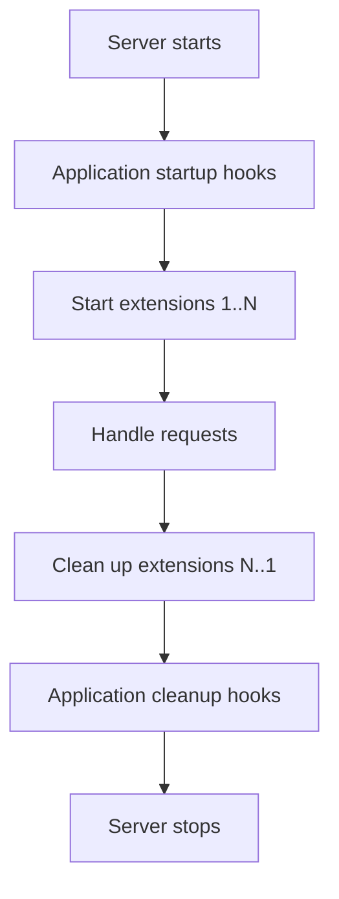

# Extensions and server adapters

[← Guide index](./README.en.md)

[한국어](./ExtensionsAndServers.md)

An extension is a reusable component that can register routes or prepare resources when an application starts and clean them up when it stops. A server adapter is the transport layer that runs the same `Application` on a selected HTTP server.

## Built-in extensions

Pass an ordered sequence of extension instances through `Application(exts=(...))`. Extensions start when the application starts and clean up in reverse startup order when it stops.

| Extension | Purpose |
| --- | --- |
| `Ping` | Simple health-check response |
| `Status` | Browser-readable status page |
| `Metrics` | Collect request counts, durations, and related metrics |
| `SpecificationsJSON` | Serve an OpenAPI JSON document from route declarations |
| `SpecificationsYAML` | Serve the same OpenAPI document as YAML |
| `Swagger` | Provide a UI for browsing the configured OpenAPI document |
| `File` | Respond with a configured file or resource |
| `FileSystem` | Provide file-serving routes backed by a filesystem |

Register only the extensions the application needs:

```python
from RedStar import Application
from RedStar.Extensions import (
  Metrics,
  Ping,
  SpecificationsJSON,
  SpecificationsYAML,
  Swagger,
)


application = Application(exts=(
  Metrics('/metrics'),
  Ping('/ping'),
  SpecificationsJSON('/api/doc/json', title='Example API'),
  SpecificationsYAML('/api/doc/yaml', title='Example API'),
  Swagger('/swagger', spec_uri='/api/doc/json'),
))
```

`SpecificationsJSON` and `SpecificationsYAML` serve the same OpenAPI 3.1 document by default as `application/json` and `application/yaml`, respectively. `Swagger` fetches the document from `spec_uri`, so register one of the two extensions at that path. Replace existing `Specifications` uses with `SpecificationsJSON`, or use `SpecificationsYAML` when a YAML response is needed. The accuracy of the specification depends on handler `summary`, `description`, `tags`, input content, and response definitions. Consider whether access to status, metrics, and documentation endpoints should be restricted in production.

## Select an OpenAPI version and declare 3.2 features

Select the OpenAPI version with a document generator. Existing calls continue to use 3.1. When you need 3.2 features, pass a `Specifications32` instance to either the JSON or YAML extension.

```python
from RedStar.Extensions import (
  Specifications32,
  SpecificationsJSON,
  SpecificationsYAML,
)


json_specification = SpecificationsJSON(
  '/openapi.json',
  specification=Specifications32(),
)
yaml_specification = SpecificationsYAML(
  '/openapi.yaml',
  specification=Specifications32(),
)
```

`Specifications31` and `Specifications32` select document format and operation semantics. In 3.2, `QUERY` becomes the fixed `query` operation, while custom methods such as `LINK` are placed under `additionalOperations` on their Path Item. Version 3.1 retains the existing `x-redstar-operations` representation for custom methods.

### The entire query string

An existing `QueryString` declaration continues to generate one `in: query` parameter per key. To describe the entire query string as one content-based parameter, specify both `name` and `content`. RedStar parses request query data using `application/x-www-form-urlencoded` rules before validating `request.qs`, so this declaration is restricted to that media type.

```python
from RedStar import Content, QueryString
from RedStar.Descriptor import Integer, Object, Properties
from RedStar.Validator.Patterns import ToInteger


filters = QueryString(
  {'limit': ToInteger()},
  requires='limit',
  name='filters',
  content=Content(
    'application/x-www-form-urlencoded',
    Object(properties=Properties(limit=Integer())),
  ),
)
```

Keep the content schema consistent with the existing `QueryString` validator. A missing name or content, or a different media type, is rejected. This parameter can only be represented by OpenAPI 3.2, so the 3.1 generator raises an error instead of silently omitting it.

### Sequential bodies and discriminators

`Content.item_schema` declares the schema for each sequential item. Supported media types are `text/event-stream`, `application/jsonl`, `application/json-seq`, and `multipart/mixed`. The same `Content` model is used by `Body` and `ResponseSpecification`, so it can be declared for both requests and responses. A named `Schema` produces a reference in `components/schemas`.

```python
from RedStar import Body, Content, ResponseSpecification
from RedStar.Descriptor import Integer, Object, Properties, Schema
from RedStar.IO.Readers import StreamContentReader


request_body = Body(
  StreamContentReader(),
  content=Content(
    'application/jsonl',
    item_schema=Schema(
      'Event',
      Object(properties=Properties(id=Integer())),
    ),
  ),
)
response = ResponseSpecification(
  200,
  'Event stream',
  Content(
    'text/event-stream',
    item_schema=Object(properties=Properties(id=Integer())),
  ),
)
```

Use `item_encoding` and `prefix_encoding` only with multipart content, and provide either `item_schema` or an array schema. The former accepts one encoding object; the latter accepts a sequence of positional encoding objects. They can also be used with an array schema in `multipart/form-data`.

`OneOf` converts its `discriminator` string to OpenAPI `propertyName` and supports `mapping` and the 3.2-only `default_mapping`. Declare the default and named schemas through the existing `Descriptor` API. The 3.1 generator raises an error if `default_mapping` is specified.

| OpenAPI 3.2 change | RedStar support |
| --- | --- |
| `QUERY`, `additionalOperations` | Supported |
| `querystring` | Supported with `application/x-www-form-urlencoded` content |
| Sequential `itemSchema` | Supported for the four media types listed above |
| `itemEncoding`, `prefixEncoding` | Supported for multipart content with schema validation |
| Discriminator `mapping`, `defaultMapping` | Supported; `default_mapping` is limited to 3.2 |
| Tag/Server metadata, generic cookie parameters | Excluded; no corresponding public declarations |
| OAuth2 device authorization/metadata, extended Example Objects, `$self` | Excluded; no corresponding public declarations |
| HTTP chunked framing, WebSocket, custom sequential media types | Outside this issue's scope |

An extension instance can belong to only one `Application`. Do not share an instance across applications; create a fresh instance for each one. A custom extension can implement the `Extension` contract and provide request, response, error, startup, and cleanup hooks.

## Register handlers from modules

`Application.load(mod=...)` or `Application.load(path=...)` finds and registers concrete `RequestRunner` subclasses in loaded modules. This separates handler definitions from application setup.

```python
from RedStar import Application


application = Application()
application.load(mod='myapp.handlers')
```

The module must be importable at runtime, and each discovered handler must have a valid `method` and `url`. Missing handlers and duplicate routes are not silently ignored; registration raises an error.

## Choose a server

The built-in Python adapter works without an external server package:

```python
from RedStar.Adapter.Implements.Python import Server

server = Server('127.0.0.1', 8000, application)
server.run()
```

| Adapter | Install | Behavior and considerations |
| --- | --- | --- |
| Python | Default install | Uses the standard library threaded HTTP server; suitable for development and basic use |
| Gunicorn | `py-wsgi-redstar[Gunicorn]` | POSIX only. Cannot run on Windows; use Linux or WSL |
| Uvicorn | `py-wsgi-redstar[Uvicorn]` | Runs the synchronous app through the `a2wsgi` boundary. Application instances require `workers=1`, `reload=False` |

The Gunicorn adapter accepts `host`, `port`, `workers`, `worker_class`, and additional Gunicorn options. It raises an error when run on Windows, so do not try to run it in native Windows.

The Uvicorn adapter provides `wsgi_workers` and `send_queue_size`; both must be positive. It does not allow `workers` greater than one or `reload=True`. The adapter manages WebSocket framing; configure WebSocket limits and behavior in the handler rather than passing Uvicorn `ws` options.

`wsgi_workers` is the number of adapter-side workers that execute the synchronous application, not the number of Uvicorn process workers. If you need more processes, review application state sharing, how often startup/cleanup runs, and whether extension instances are created per process. This adapter does not allow one `Application` instance to be shared across multiple Uvicorn workers.

## Server startup and shutdown

Server adapters call application startup and stop methods. On startup, application startup hooks run before extensions start in order. On shutdown, extensions clean up in reverse order, followed by application cleanup hooks.



See [Application lifecycle](./Lifecycle.en.md) for lifecycle and normal request/response hooks, and [Error handling](./ErrorHandling.en.md) for error hooks and exceptions.
