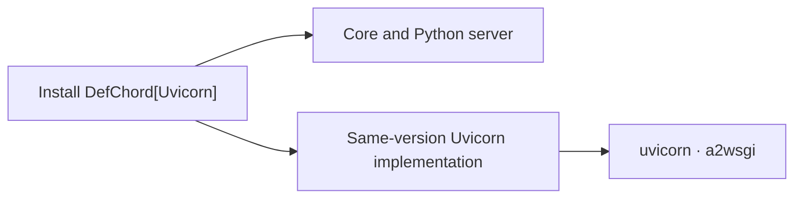

# Installation isolation, development and distribution

[한국어](./Packaging.md) · [Guide index](./README.en.md)

## Installed files

`DefChord` contains only the core and built-in Python server. The `Gunicorn` and `Uvicorn` extras install the same-version `DefChord-Gunicorn` and `DefChord-Uvicorn` distributions and their external dependencies.

Metrics use the `defchord_*` names, and OpenAPI vendor extensions use the `x-defchord-*` keys.

In a new environment, unselected adapter files are absent. Omitting an extra later does not remove an installed adapter; explicitly uninstall its implementation distribution when no longer needed.



## When you want to modify the source code

To fix or add features, use a development installation. An **editable installation** connects Python to your local source code so it can use that code directly.

Download the repository, activate a development virtual environment, and run the following command from the top-level folder containing `setup.py`. Here, `.` means the current folder and `-e` means an editable installation. You need pip 23 or later.

```shell
python -m pip install -e .
```

This connects the common code and built-in Python server. To also install the Uvicorn or Gunicorn adapter libraries, list their names with standard extras syntax. The following commands are separate examples: the first selects Uvicorn only, and the second selects both adapters.

```shell
python -m pip install -e ".[Uvicorn]"
python -m pip install -e ".[Gunicorn,Uvicorn]"
```

Unlike the distributed split layout, the editable installation links the repository's common code and all Gunicorn and Uvicorn implementation sources; the selected extra installs only that implementation's external libraries. It therefore works without published `DefChord-Uvicorn` or `DefChord-Gunicorn` distributions. Reinstalling with another extra does not automatically remove previously installed external libraries.

### Try your changes

1. Edit the code under `src/`.
2. Start your application or tests again in the same virtual environment to check the result. Code in an already running program is not automatically reloaded.
3. If you add files or change the installation configuration, repeat the installation command with the desired extras.

The command connects the sources already on your computer. It does not fetch remote changes; pip resolves external libraries in its standard way. The Uvicorn and Gunicorn adapter sources are linked editably as well.

### How the development connection works

A build from the repository without the `DEF_BUILD_TARGET` environment variable is treated as a development build. Distribution wheels and sdists keep the split layout because `scripts/build.py` sets the target explicitly. After changing the installation configuration, repeat the installation command, and restart the language server if the IDE does not find the installed code right away. Each virtual environment keeps its own installation state.

## Build and validate

Installation checks explicitly select the locally built core and implementation wheels. Same-version files from PyPI cannot replace those validation artifacts; external dependencies still come from the package index.

Build and validate all distributions from the repository root:

```shell
python -m pip install "pip>=23" build "setuptools>=77" "setuptools-scm>=8,<10" wheel twine
python scripts/build.py
python .github/scripts/check_distributions.py --editable
python -m twine check --strict dist/*
```

Build dependencies are declared in `setup.py` using `setup_requires`. With no `pyproject.toml`, pip uses its default setuptools backend.

The build script fixes the version once, then creates each target's wheel and sdist in `dist/`. Use an output directory without other versions' artifacts. `--outdir` selects another directory; `--wheel` builds only wheels.

Each sdist includes `.distribution-target`, so `python -m build` recreates the same distribution without a target environment variable. Changing an sdist's target is rejected.

`TargetEggInfo.find_sources()` in `setup.py` maintains the additional build sources included in sdists. No separate `MANIFEST.in` is used. This source list does not install helper scripts into regular wheels.

Sdists contain the shared source tree. Unselected implementation files are excluded from built wheels and installed files; the source archives themselves are not split into isolated source trees.

CI builds and checks supported Python versions. Releases verify every distribution name, version and build number, then publish implementations before the core. Publishing permissions and the PyPI token must cover all distribution names. Local builds do not publish anything.
