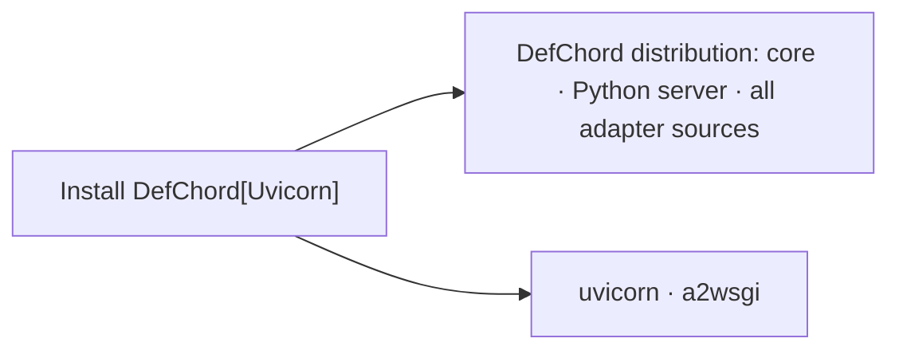

# Installation layout, development and distribution

[한국어](./Packaging.md) · [Guide index](./README.en.md)

## Installed files

A single `DefChord` distribution contains the core, the built-in Python server and the Gunicorn and Uvicorn adapter sources. The same files are installed whether or not extras are given, and the public Python import path is `DefChord`. No compatibility alias is provided for the former name.

The `Gunicorn` and `Uvicorn` extras only install the external dependencies those adapters need.

| Extra | Additional external dependencies |
| --- | --- |
| `Gunicorn` | `gunicorn>=23` |
| `Uvicorn` | `uvicorn>=0.30`, `a2wsgi>=1.10` |

Metrics use the `defchord_*` names, and OpenAPI vendor extensions use the `x-defchord-*` keys.



Without extras the adapter sources are still present, but an adapter cannot be imported or run until its external dependencies are installed.

## When you want to modify the source code

To fix or add features, use a development installation. An **editable installation** connects Python to your local source code so it can use that code directly.

Download the repository, activate a development virtual environment, and run the following command from the top-level folder containing `setup.py`. `.` means the current folder, `-e` means an editable installation, and pip 23 or later is required.

```shell
python -m pip install -e ".[Gunicorn,Uvicorn]"
```

All sources are always connected; the extras in brackets only decide whether the adapters' external libraries are installed. You can list only the adapters you need, for example `".[Uvicorn]"`.

1. Edit the code under `src/`.
2. Start your application or tests again in the same virtual environment to check the result. Code in an already running program is not automatically reloaded.
3. If you add files or change the installation configuration, repeat the installation command.

The command connects the sources already on your computer and does not fetch remote changes. The connection uses setuptools' standard editable installation. Restart the language server if the IDE does not find the installed code right away.

## Build and validate

Build and validate the distribution from the repository root:

```shell
python -m pip install "pip>=23" build "setuptools>=77" "setuptools-scm>=8,<10" wheel twine
python -m build
python .github/scripts/check_distributions.py --editable
python -m twine check --strict dist/*
```

`python -m build` creates one wheel and one sdist for `DefChord` in `dist/`. Use an output directory without other versions' artifacts. The check script verifies the wheel's name, extras and adapter sources, then installs the `DefChord[Gunicorn,Uvicorn]` wheel and an editable installation into fresh virtual environments and validates `pip check` and imports. The sdist contains the source tree and the `README.setup.md` read by `setup.py`.

CI builds and checks supported Python versions. Releases verify the `DefChord` name, version and build number before publishing. Local builds do not publish anything.
