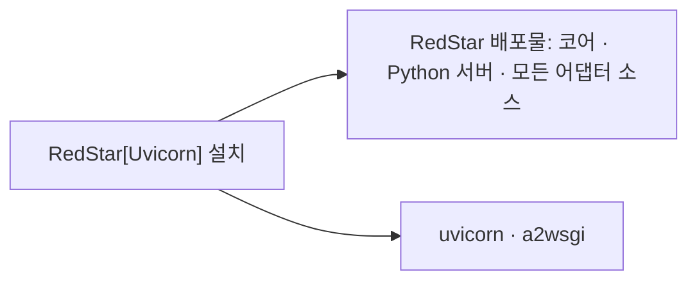

# 설치 구성과 개발·배포

[English](./Packaging.en.md) · [매뉴얼 목차](./README.md)

## 무엇이 설치되는가

`RedStar` 배포물 하나에 코어, 기본 Python 서버, Gunicorn·Uvicorn 어댑터 소스가 모두 포함됩니다. extras 지정 여부와 관계없이 같은 파일이 설치되며, 공개 Python import 경로는 `RedStar`입니다. 기존 이름의 호환 alias는 제공하지 않습니다.

`Gunicorn`과 `Uvicorn` extras는 해당 어댑터가 필요로 하는 외부 의존성만 추가로 설치합니다.

| extra | 추가로 설치되는 외부 의존성 |
| --- | --- |
| `Gunicorn` | `gunicorn>=23` |
| `Uvicorn` | `uvicorn>=0.30`, `a2wsgi>=1.10` |

Metrics는 `redstar_*` 이름을, OpenAPI vendor extension은 `x-redstar-*` 키를 사용합니다.



extras 없이 설치해도 어댑터 소스는 존재하지만, 해당 외부 의존성이 없으면 어댑터를 import하거나 실행할 수 없습니다.

## 소스 코드를 직접 수정하고 싶을 때

기능을 고치거나 추가하고 싶다면 개발용 설치를 사용하세요. 내려받은 소스 코드를 Python이 직접 사용하도록 연결하는 방식을 **editable 설치**라고 합니다.

저장소를 내려받고 개발용 가상환경을 활성화한 뒤, `setup.py`가 있는 저장소 최상위 폴더에서 실행하세요. `.`은 현재 폴더, `-e`는 editable 설치를 뜻하며 pip 23 이상이 필요합니다.

```shell
python -m pip install -e ".[Gunicorn,Uvicorn]"
```

모든 소스가 항상 연결되며, 대괄호의 extras는 어댑터에 필요한 외부 라이브러리 설치 여부만 정합니다. 필요한 어댑터만 `".[Uvicorn]"`처럼 지정할 수 있습니다.

1. `src/` 아래의 코드를 수정합니다.
2. 같은 가상환경에서 애플리케이션이나 테스트를 새로 실행해 결과를 확인합니다. 이미 실행 중인 프로그램의 코드는 자동으로 다시 로드되지 않습니다.
3. 새 파일을 추가했거나 설치 구성을 바꿨다면 설치 명령을 다시 실행합니다.

이 명령은 컴퓨터에 있는 현재 소스를 연결할 뿐, 원격 저장소의 변경을 가져오지 않습니다. 연결 방식은 setuptools의 표준 editable 설치를 따릅니다. IDE가 설치 결과를 바로 찾지 못하면 Language Server를 재시작하세요.

## 빌드와 검증

저장소 루트에서 배포물을 빌드·검사합니다.

```shell
python -m pip install "pip>=23" build "setuptools>=77" "setuptools-scm>=8,<10" wheel twine
python -m build
python .github/scripts/check_distributions.py --editable
python -m twine check --strict dist/*
```

`python -m build`는 `dist/`에 `RedStar`의 wheel과 sdist를 하나씩 만듭니다. 다른 버전의 산출물이 섞이지 않은 출력 디렉터리를 사용하세요. 검사 스크립트는 wheel의 이름·extras·어댑터 소스 포함 여부를 확인하고, 새 가상환경에 `RedStar[Gunicorn,Uvicorn]` wheel과 editable 설치를 각각 설치해 `pip check`와 import를 검증합니다. sdist에는 `setup.py`가 읽는 `README.setup.md`와 소스 트리가 포함됩니다.

CI는 지원 Python별 빌드·설치 검사를 수행하며, 릴리즈에서는 `RedStar`의 이름·버전·빌드 번호를 확인한 뒤 게시합니다. 로컬 빌드는 게시를 수행하지 않습니다.
